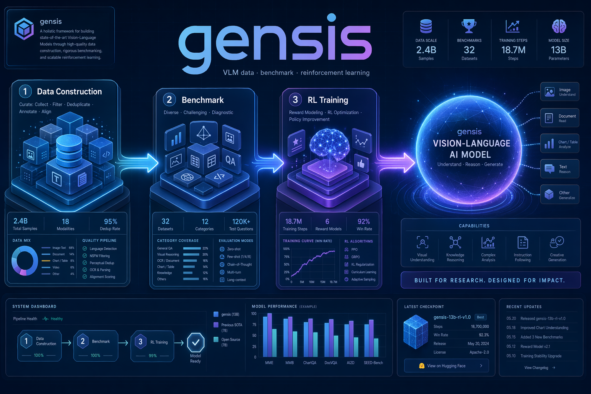

# gensis



面向 **VLM（视觉语言模型）** 的一体化工作台:**数据构建 · 基准评测 · 强化学习**。
三个模块串成一条从造数据、造 benchmark 到 RL 后训练的完整链路。

## 模块

| 模块 | 说明 | 示意 |
| --- | --- | --- |
| [**ZeroGeneration**](ZeroGeneration) | 零样本合成数据构建 —— 以公开 benchmark 为种子，用 Gemini + GPT-Image-2 + Qwen-VL 两阶段"编辑 → 多样化"批量产出「新图 + 问题 + 答案 + CoT」训练样本 |  |
| [**Unreal_Benchmark_Pipeline**](Unreal_Benchmark_Pipeline) | 高难度视觉推理 benchmark 合成 —— seed → 场景 → GPT-Image-2 生图 → 独立 VLM 闭卷验证 → 发布与多模型评测 |  |
| [**RL_Training**](RL_Training) | Qwen3-VL 强化学习后训练 —— GRPO / RLVR + LLM-as-judge，含 zerovision 执行脚本与 verl 自定义 RL 代码 |  |

## 典型链路

```
ZeroGeneration ──(合成训练/评测数据 parquet)──► RL_Training ──► 更强的 VLM
Unreal_Benchmark_Pipeline ──(高难度 benchmark)──► 评测 VLM
```

各模块的详细设计、快速开始与配置见其目录下的 README。项目图示在 [`assets/`](assets)。

> 密钥安全:各模块脚本中的 API key 均已替换为 `YOUR_*` 占位符，改由 `.env` 注入；
> `.gitignore` 已忽略 `.env`（保留 `.env.example`）。
