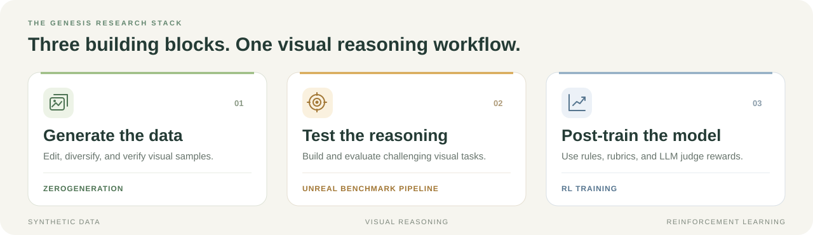

<div align="center">


# Genesis

**Data generation · Visual benchmarks · Reinforcement learning**

从合成视觉数据到模型后训练，构建面向视觉推理的完整研究链路。

[](https://github.com/CauchyFanUpdate/gensis)
[](https://huggingface.co/CauchyFan)
[](https://huggingface.co/datasets/CauchyFan/UNREAL_Benchmark)

[Overview](#overview) · [Models](#models) · [Datasets](#datasets) · [Quick Start](#quick-start) · [Documentation](#documentation)

</div>

<br>

## Overview

**Genesis** 将视觉语言模型（VLM）的数据构建、基准评测与强化学习后训练整合在一个工作台中。
以公开 benchmark 或场景 seed 为起点，生成并校验视觉推理样本，再通过规则奖励与 LLM judge 支持模型后训练。

<p align="center">
  
</p>

| Module | What it does | Explore |
| --- | --- | --- |
| **ZeroGeneration** | 图像编辑、考点保持的多样化、自动校验与 CoT 生成，产出训练样本。 | [数据构建文档](ZeroGeneration/README.md) |
| **Unreal Benchmark Pipeline** | 从场景 seed 生成高难度视觉推理题，经独立 VLM 校验后发布与评测。 | [基准构建文档](Unreal_Benchmark_Pipeline/README.md) |
| **RL Training** | 基于自定义 verl 的 GRPO / RLVR 后训练，支持 LLM-as-judge 与 rubric 奖励。 | [训练文档](RL_Training/README.md) |

## Models

已发布的 Genesis 模型权重均托管于 [Hugging Face · CauchyFan](https://huggingface.co/CauchyFan)。

| Model | Family | Scale |
| --- | --- | ---: |
| [**Genesis-Qwen3vl-4B**](https://huggingface.co/CauchyFan/Genesis-Qwen3vl-4B) | Qwen3-VL | 4B |
| [**Genesis-Qwen3vl-8B**](https://huggingface.co/CauchyFan/Genesis-Qwen3vl-8B) | Qwen3-VL | 8B |
| [**Genesis-Qwen3vl-32B**](https://huggingface.co/CauchyFan/Genesis-Qwen3vl-32B) | Qwen3-VL | 32B |
| [**Genesis-Qwen3.5-9B**](https://huggingface.co/CauchyFan/Genesis-Qwen3.5-9B) | Qwen3.5 | 9B |
| [**Genesis-Qwen3.6-27B**](https://huggingface.co/CauchyFan/Genesis-Qwen3.6-27B) | Qwen3.6 | 27B |

下载示例：

```bash
hf download CauchyFan/Genesis-Qwen3vl-4B \
  --local-dir checkpoints/Genesis-Qwen3vl-4B
```

## Datasets

### [UNREAL Benchmark ↗](https://huggingface.co/datasets/CauchyFan/UNREAL_Benchmark)

**600 道视觉推理题 · 5 个领域 · 英文题目 · 内嵌图像**

面向陌生场景中的视觉问答，覆盖数学、自然科学、感知、物理与工程、推理与逻辑。
包含 458 道开放式问题与 142 道选择题，每条样本提供图像、问题与参考答案。

<table>
<tr>
<td align="center" width="33%">
  <a href="https://huggingface.co/datasets/CauchyFan/UNREAL_Benchmark">
    
  </a><br>
  <strong>Physics &amp; Engineering</strong><br>
  <sub>从场景中推理物理规律</sub>
</td>
<td align="center" width="33%">
  <a href="https://huggingface.co/datasets/CauchyFan/UNREAL_Benchmark">
    
  </a><br>
  <strong>Mathematics</strong><br>
  <sub>理解图像中的数学关系</sub>
</td>
<td align="center" width="33%">
  <a href="https://huggingface.co/datasets/CauchyFan/UNREAL_Benchmark">
    
  </a><br>
  <strong>Reasoning &amp; Logic</strong><br>
  <sub>识别细节与语义中的矛盾</sub>
</td>
</tr>
</table>

```python
from datasets import load_dataset

benchmark = load_dataset("CauchyFan/UNREAL_Benchmark", split="train")
sample = benchmark[0]
image, question = sample["image"], sample["question"]
```

发布文件沿用 `train` split 命名，内容用于基准评测。完整字段说明、领域分布与更多样例见 [dataset card](https://huggingface.co/datasets/CauchyFan/UNREAL_Benchmark)。

## Quick Start

### 1. Get the code

```bash
git clone git@github.com:CauchyFanUpdate/gensis.git
cd gensis
```

### 2. Choose your workflow

各模块有独立的环境与输入配置，按目标选择对应入口：

| Goal | Start here |
| --- | --- |
| **构建合成数据** | [ZeroGeneration 快速开始](ZeroGeneration/README.md#3-快速开始)：配置模型 API 和原始数据，运行两阶段生成流程。 |
| **生成与评测 benchmark** | [Unreal Benchmark Pipeline](Unreal_Benchmark_Pipeline/README.md)：场景生成 → 生图 → 独立校验 → 发布与多模型评测。 |
| **运行强化学习后训练** | [RL Training 快速开始](RL_Training/README.md#3-快速开始)：准备 verl、自定义奖励、模型权重与训练配置。 |

以数据构建为例，按照模块文档准备依赖、API 配置与输入数据后，可先运行 10 条样本：

```bash
cd ZeroGeneration
cp .env.example .env
# 配置 .env，并按模块文档加载环境变量与设置输入数据路径。
LIMIT=10 STAGE=1 bash gen_pipeline_emma/run_pipeline_v5.sh
```

### 3. Use the releases

从上方 [Models](#models) 获取模型权重，或从 [UNREAL Benchmark](#datasets) 开始评测。
数据构建、模型训练与评测的详细参数保留在各模块文档中。

## Documentation

```text
gensis/
├── ZeroGeneration/                 # 合成数据：编辑、多样化、校验与 CoT
├── Unreal_Benchmark_Pipeline/      # 视觉推理基准：构建、发布与评测
├── RL_Training/                    # 强化学习：脚本、配置与 verl 自定义代码
│   ├── scripts/                    # 训练、转换、奖励与评测入口
│   └── verl_custom/                # 自定义模块及接入说明
└── assets/                         # 项目标识与流程图
```

- [数据构建：设计、数据集 pipeline 与输入格式](ZeroGeneration/README.md)
- [Benchmark：生成流程与评测入口](Unreal_Benchmark_Pipeline/README.md)
- [强化学习：算法、奖励与启动方式](RL_Training/README.md)
- [自定义 verl：代码接入说明](RL_Training/verl_custom/APPLY.md)
- [SAPO：训练配置说明](RL_Training/scripts/README_SAPO.md)

---

<div align="center">

**Genesis** · Data, benchmarks, and training for visual reasoning.

[Code](https://github.com/CauchyFanUpdate/gensis) · [Model Weights](https://huggingface.co/CauchyFan) · [UNREAL Benchmark](https://huggingface.co/datasets/CauchyFan/UNREAL_Benchmark)

</div>
