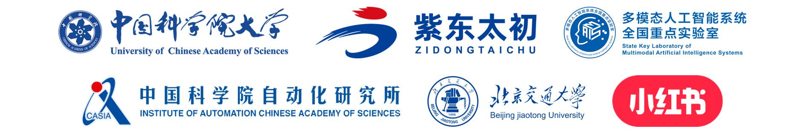
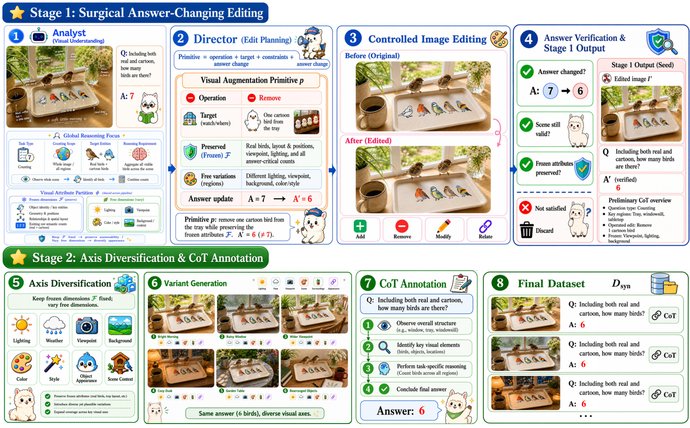

<div align="center">


# Genesis

### *Visual Augmentation Primitives for<br>Multimodal Chain-of-Thought Reasoning*

**🎉 Accepted to the EMNLP 2026 Main Conference**

Fan Yang<sup>*</sup> · Lifeng Chen<sup>*</sup> · Yipu Wang<sup>*</sup> · Han Wang<sup>*</sup> · Feilong Chen<sup>†</sup> · Yidong Ma<br>
Zhiyang Chen · Chaoyang Zhao<sup>†</sup> · Lingxiang Wu · Hanqi Jiang · Yibo Chen · Xu Tang<br>
Yao Hu · Ming Tang · Xiaojie Jin · Xiaolong Zheng · Jinqiao Wang<sup>†</sup>

<sub>* Equal contribution &nbsp; † Corresponding authors</sub>



[](https://arxiv.org/abs/2610.15565)
[](https://arxiv.org/html/2610.15565v1)
[](https://huggingface.co/CauchyFan)
[](https://huggingface.co/datasets/CauchyFan/UNREAL_Benchmark)

[**📄 Paper**](https://arxiv.org/abs/2610.15565) · [**🤗 Models**](#models) · [**📊 Data**](#dataset) · [**🌀 Usage**](#get-started) · [**📚 Citation**](#citation)

</div>

---

Welcome to the official repository of **Genesis**. This work studies how to connect visual observations with intermediate reasoning. It combines controlled image augmentation, supervision over reasoning steps, and evaluation on scenes that challenge language priors.

[News](#news) · [Method](#method) · [Results](#results) · [Models](#models) · [Dataset](#dataset) · [Get Started](#get-started) · [Citation](#citation)

## News

- [x] **EMNLP 2026:** Genesis is accepted to the **Main Conference**.
- [x] **Paper:** The [arXiv preprint](https://arxiv.org/abs/2610.15565) is available, submitted on October 11, 2026.
- [x] **Models:** Five [Genesis checkpoints](#models) are available on Hugging Face.
- [x] **Benchmark:** [UNREAL Benchmark](https://huggingface.co/datasets/CauchyFan/UNREAL_Benchmark) is available with images, questions, and reference answers.
- [x] **Code:** Data construction, benchmark evaluation, and RL training workflows are included in this repository.

## Method

Genesis has three components:

1. **Visual Augmentation Primitives (VAP).** Controlled edits change answers; a second stage varies other visual attributes while preserving the task and adding reasoning annotations.
2. **Multimodal CoT rubric-based RL.** Rewards assess intermediate visual reasoning alongside final answers.
3. **UNREAL Benchmark.** An independent evaluation suite tests reasoning on generated scenes that challenge everyday expectations.

<p align="center">
  <a href="assets/genesis-vap-pipeline.png">
    
  </a><br>
  <sub>VAP pipeline, Figure 2 of <a href="https://arxiv.org/html/2610.15565v1#S3.F2">Yang et al., 2026</a>. Original figure, <a href="https://creativecommons.org/licenses/by/4.0/">CC BY 4.0</a>.</sub>
</p>

| Component | Code | Guide |
| --- | --- | --- |
| **Visual data construction** | [`ZeroGeneration/`](ZeroGeneration) | [Pipeline design and configuration](ZeroGeneration/README.md) |
| **Benchmark construction & evaluation** | [`Unreal_Benchmark_Pipeline/`](Unreal_Benchmark_Pipeline) | [Benchmark workflow](Unreal_Benchmark_Pipeline/README.md) |
| **Rubric-based RL training** | [`RL_Training/`](RL_Training) | [Training and reward configuration](RL_Training/README.md) |

## Results

Selected results from the paper's [Table 1](https://arxiv.org/html/2610.15565v1#S6.T1) and [Table 3](https://arxiv.org/html/2610.15565v1#S6.T3). Scores are accuracy (%); the rows pair each Genesis model with its corresponding Qwen3-VL baseline.

| Model | MathVista | MMMU | MMMU-Pro | EMMA | LogicVista | BabyVision | UNREAL |
| --- | ---: | ---: | ---: | ---: | ---: | ---: | ---: |
| Qwen3-VL-4B | 74.3 | 63.3 | 36.0 | 30.5 | 50.3 | 15.0 | 12.8 |
| **Genesis-4B** | 77.6 | 63.4 | 53.9 | 32.8 | 60.0 | 16.8 | 14.2 |
| Qwen3-VL-8B | 78.2 | 63.6 | 41.4 | 31.0 | 55.9 | 10.8 | 17.5 |
| **Genesis-8B** | 78.8 | 66.0 | 56.7 | 35.8 | 59.7 | 15.2 | 19.1 |
| Qwen3-VL-32B | 82.9 | 68.2 | 47.9 | 38.1 | 63.5 | 16.0 | 24.3 |
| **Genesis-32B** | 82.4 | 75.4 | 66.5 | 46.5 | 68.5 | 14.4 | 25.7 |

Full results, domain breakdowns, and ablations are in the [paper](https://arxiv.org/abs/2610.15565). These are paper-reported results for the Qwen3-VL variants.

## Models

### Models evaluated in the paper

| Model | Base family | Scale | Download |
| --- | --- | ---: | --- |
| **Genesis-4B** | Qwen3-VL | 4B | [🤗 Genesis-Qwen3vl-4B](https://huggingface.co/CauchyFan/Genesis-Qwen3vl-4B) |
| **Genesis-8B** | Qwen3-VL | 8B | [🤗 Genesis-Qwen3vl-8B](https://huggingface.co/CauchyFan/Genesis-Qwen3vl-8B) |
| **Genesis-32B** | Qwen3-VL | 32B | [🤗 Genesis-Qwen3vl-32B](https://huggingface.co/CauchyFan/Genesis-Qwen3vl-32B) |

### Additional released checkpoints

| Model | Base family | Scale | Download |
| --- | --- | ---: | --- |
| **Genesis-Qwen3.5-9B** | Qwen3.5 | 9B | [🤗 Hugging Face](https://huggingface.co/CauchyFan/Genesis-Qwen3.5-9B) |
| **Genesis-Qwen3.6-27B** | Qwen3.6 | 27B | [🤗 Hugging Face](https://huggingface.co/CauchyFan/Genesis-Qwen3.6-27B) |

Download a checkpoint:

```bash
hf download CauchyFan/Genesis-Qwen3vl-4B \
  --local-dir checkpoints/Genesis-Qwen3vl-4B
```

## Dataset

### [UNREAL Benchmark ↗](https://huggingface.co/datasets/CauchyFan/UNREAL_Benchmark)

**600 questions · 5 domains · Embedded images · English**

The released benchmark covers mathematics, natural science, perception, physics and engineering, and reasoning and logic. It contains **458 open-ended** and **142 multiple-choice** questions, each paired with an image and reference answer.

<table>
<tr>
<td align="center" width="33%">
  <a href="https://huggingface.co/datasets/CauchyFan/UNREAL_Benchmark">
    
  </a><br>
  <strong>Physics &amp; Engineering</strong><br>
  <sub>Reason about physical rules</sub>
</td>
<td align="center" width="33%">
  <a href="https://huggingface.co/datasets/CauchyFan/UNREAL_Benchmark">
    
  </a><br>
  <strong>Mathematics</strong><br>
  <sub>Read mathematical relationships</sub>
</td>
<td align="center" width="33%">
  <a href="https://huggingface.co/datasets/CauchyFan/UNREAL_Benchmark">
    
  </a><br>
  <strong>Reasoning &amp; Logic</strong><br>
  <sub>Detect contradictions in a scene</sub>
</td>
</tr>
</table>

```python
from datasets import load_dataset

benchmark = load_dataset("CauchyFan/UNREAL_Benchmark", split="train")
sample = benchmark[0]
image, question = sample["image"], sample["question"]
```

The release uses the split name `train`, but its intended role is **evaluation**. See the [dataset card](https://huggingface.co/datasets/CauchyFan/UNREAL_Benchmark) for fields, domain counts, and additional examples.

## Get Started

### 1. Clone the repository

```bash
git clone git@github.com:CauchyFanUpdate/gensis.git
cd gensis
```

### 2. Data construction

Follow the [ZeroGeneration guide](ZeroGeneration/README.md#3-快速开始) to prepare dependencies, API configuration, and input data. Then run a small Stage 1 job:

```bash
cd ZeroGeneration
cp .env.example .env
# Configure and load the environment, and set input data paths as described in the guide.
LIMIT=10 STAGE=1 bash gen_pipeline_emma/run_pipeline_v5.sh
```

### 3. Training

Start with the [RL Training guide](RL_Training/README.md#3-快速开始) and [custom verl integration](RL_Training/verl_custom/APPLY.md). The training module includes GRPO / SAPO configurations, rubric and LLM-judge rewards, single-node and multi-node launchers, and checkpoint conversion scripts.

### 4. Evaluation

Use the released [UNREAL Benchmark](#dataset) with the [evaluation scripts](Unreal_Benchmark_Pipeline/UNREAL_Benchmark/eval):

- [`eval_vllm.py`](Unreal_Benchmark_Pipeline/UNREAL_Benchmark/eval/eval_vllm.py) for local model evaluation.
- [`eval_api.py`](Unreal_Benchmark_Pipeline/UNREAL_Benchmark/eval/eval_api.py) for API-based models.
- [Benchmark construction guide](Unreal_Benchmark_Pipeline/README.md) for scene generation, verification, and release workflows.

Module guides are currently written in Chinese.

<details>
<summary><strong>Repository structure and additional documentation</strong></summary>

```text
gensis/
├── ZeroGeneration/                 # Synthetic data and CoT generation
├── Unreal_Benchmark_Pipeline/      # Benchmark construction and evaluation
├── RL_Training/                    # Training scripts and custom verl modules
│   ├── scripts/                    # Training, conversion, and evaluation
│   └── verl_custom/                # Custom rewards and integration guide
├── assets/                         # Project artwork and paper figure
└── CITATION.cff                    # Machine-readable paper citation
```

- [ZeroGeneration](ZeroGeneration/README.md)
- [Unreal Benchmark Pipeline](Unreal_Benchmark_Pipeline/README.md)
- [RL Training](RL_Training/README.md)
- [Custom verl integration](RL_Training/verl_custom/APPLY.md)
- [SAPO configurations](RL_Training/scripts/README_SAPO.md)

</details>

## Citation

If Genesis, its models, or UNREAL Benchmark help your research, please cite:

```bibtex
@misc{yang2026genesisvisualaugmentationprimitives,
      title={Genesis: Visual Augmentation Primitives for Multimodal Chain-of-Thought Reasoning},
      author={Fan Yang and Lifeng Chen and Yipu Wang and Han Wang and Feilong Chen and Yidong Ma and Zhiyang Chen and Chaoyang Zhao and Lingxiang Wu and Hanqi Jiang and Yibo Chen and Xu Tang and Yao Hu and Ming Tang and Xiaojie Jin and Xiaolong Zheng and Jinqiao Wang},
      year={2026},
      eprint={2610.15565},
      archivePrefix={arXiv},
      primaryClass={cs.CV},
      url={https://arxiv.org/abs/2610.15565},
}
```

Citation metadata is also available in [`CITATION.cff`](CITATION.cff).

## Acknowledgements

We thank the [Qwen](https://github.com/QwenLM/Qwen3-VL), [verl](https://github.com/verl-project/verl), and [Hugging Face](https://huggingface.co/) communities for their models and tools.

---

<div align="center">

**Genesis · EMNLP 2026 Main Conference**

[Paper](https://arxiv.org/abs/2610.15565) · [Models](https://huggingface.co/CauchyFan) · [UNREAL Benchmark](https://huggingface.co/datasets/CauchyFan/UNREAL_Benchmark)

</div>
