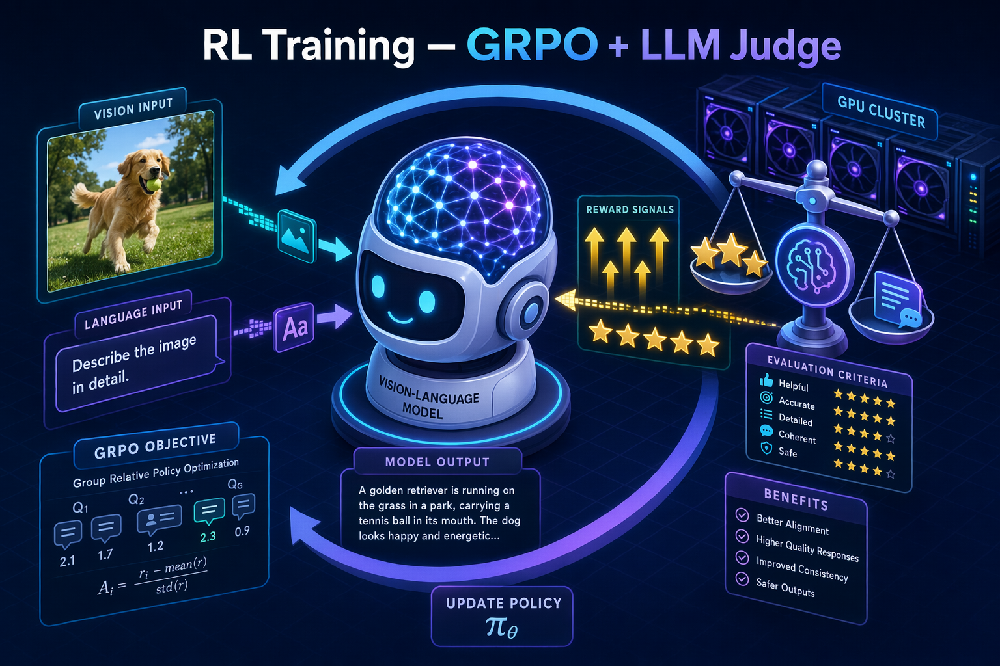

# RL_Training — VLM 强化学习（GRPO / RLVR + LLM Judge）



在 [ZeroGeneration](../ZeroGeneration) 合成的数据上，对 Qwen3-VL 系列做**强化学习后训练**。
算法为 **GRPO**（含 RLVR 规则奖励 + 可选 LLM-as-judge / rubric 奖励），框架基于
[verl](https://github.com/verl-project/verl) 的自定义 fork。

> 本目录只收录**执行脚本、配置、prompt、自定义 RL 代码与说明**，不含 verl 框架本体、
> 模型权重、parquet 数据、wandb 日志等大文件。verl 框架请按 `verl_custom/APPLY.md` 自备。

---

## 1. 组成

```
RL_Training/
├── README.md
├── .env.example                 # WANDB / judge / 路径等环境变量模板
│
├── scripts/                     # ← 来自 zerovision/scripts，训练执行层
│   ├── config/                  #   Hydra 配置（GRPO / SAPO × Qwen3.5 / Qwen3-VL）
│   │   ├── grpo_qwen3vl_4b_llm_judge.yaml      # 主用：GRPO + LLM judge
│   │   ├── grpo_qwen35_4b_llm_judge.yaml
│   │   └── sapo_*.yaml
│   ├── train/                   #   各模型规模 / 数据集的启动脚本
│   │   ├── rl_qwen3vl4b/        #     单机 4B：按数据集分（ZEROBench/MMMU/EMMA/…）
│   │   ├── rl_qwen3vl8b/        #     单机 8B
│   │   ├── rl_qwen3vl32b/       #     多机 32B（K8s + Ray，multinode + judge server）
│   │   └── rl_qwen35_4b/        #     纯文本 Qwen3.5
│   ├── shared/ray_start.sh      #   Ray 集群拉起（head 提交 / worker 阻塞）
│   ├── convert/convert_fsdp_to_hf.sh   # FSDP ckpt → HuggingFace
│   ├── eval/                    #   评测 + vLLM serve
│   ├── data/add_rubric_to_parquet.py   # 给训练集追加 rubric 字段
│   ├── llm_judge_prompt.txt / rubric_prompt.txt / rubric_sample_prompt.txt
│   └── LLM_JUDGE_INTEGRATION.md / README_SAPO.md   # 集成说明
│
└── verl_custom/                 # ← verl fork 相对上游的自定义改动（24 文件 / +2281 行）
    ├── APPLY.md                 #   如何叠加到干净 verl
    ├── verl_custom.patch        #   可 git apply 的完整 diff
    └── verl/…                   #   改动后文件就地留档（reward manager / reward_score /
                                 #   CrossView-Qwen3VL 模型 / trainer & dataset 接入）
```

---

## 2. 设计要点

### 2.1 GRPO + 混合奖励
- **算法**：GRPO（`adv_estimator=grpo`），actor 用 FSDP2，rollout 用 vLLM。
- **奖励融合**：rule-based（RLVR，答案精确匹配/规则判分）为主；对**复杂题**（如
  ZeroBench 开放式答案）回退到 **LLM judge** 打分。样本用 `extra_info.reward_type`
  （`llm_judge` / 规则）区分走哪条奖励路径。
- **rubric 模式**：`rubric_mode=general`（通用打分 rubric）或 `sample`（逐样本 rubric，
  由 `data/add_rubric_to_parquet.py` 预先写入 parquet），prompt 见 `rubric_prompt.txt`。

### 2.2 LLM Judge server（可 sleep 省显存）
- 独立 vLLM 服务（Qwen3-32B），OpenAI-兼容端点；`api-key`/`served-model-name` 约定为
  字面量 `qwen`。
- 支持 `sleep/wake`：judge 空闲时释放 GPU，训练 rollout 需要时唤醒。
- 训练进程通过 `reward.reward_kwargs.llm_judge_kwargs.base_url` 走 HTTP 调 judge。
- 起服务：`START_JUDGE_SERVER=1`（脚本内自动拉起）或独立跑
  `train/rl_qwen3vl32b/start_judge_server.sh`。

### 2.3 单机 vs 多机
- **单机**（4B/8B）：脚本直接 `python -m verl.trainer.main_ppo …`。
- **多机 32B**（`rl_qwen3vl32b/qwen3vl_grpo_rubric_multinode.sh`）：K8s 每台机跑同一脚本，
  按 `POD_NAME` 是否含 `master` 区分 Ray head/worker；head 经 `ray job submit` 提交，
  worker `sleep inf` 阻塞等待；通过 `runtime-env-json` 把环境变量下发到各节点。
- 训练结束自动 `convert_fsdp_to_hf.sh` 转 HF 格式。

### 2.4 自定义 verl 代码
核心是两个 reward manager（`llm_judge` / `spatial_consistency`）、三个 reward_score
（`zerobench` / `spatial` / `llava`）与 CrossView-Qwen3-VL 模型支持。

**每个文件要加到 verl 的哪个路径、以及需要在上游文件里插入哪些注册/接线，见
[`verl_custom/APPLY.md`](verl_custom/APPLY.md) 的逐文件对照表**（8 个新增文件直接拷贝，
16 个已有文件需按表补注册行；`verl_custom/verl/…` 内的相对路径就是 verl 仓库中的落点）。

---

## 3. 快速开始

```bash
# 0) 准备 verl（叠加自定义代码）
#    见 verl_custom/APPLY.md —— git apply verl_custom.patch 后 pip install -e .

# 1) 配置环境变量
cp .env.example .env      # 填 WANDB_API_KEY / 各路径 / JUDGE_HOST 等

# 2) 单机 4B（以 stem_final 为例，对应问题中的示例脚本）
bash scripts/train/rl_qwen3vl4b/qwen3vl_grpo_rubric_general_stem_final.sh

# 3) 多机 32B（K8s 平台在每台机执行同一脚本；手动启动见脚本头注释）
env POD_NAME=master MASTER_ADDR=<head_ip> HOST_IP=<head_ip> WORLD_SIZE=6 \
    bash scripts/train/rl_qwen3vl32b/qwen3vl_grpo_rubric_multinode.sh

# 4) 单独起 judge server（可选，供多机共享）
PORT=31001 TP=4 bash scripts/train/rl_qwen3vl32b/start_judge_server.sh
```

常用覆盖项（环境变量）：`MODEL_PATH` `TRAIN_FILE` `VAL_FILE` `CKPTS_DIR`
`ROLLOUT_TP` `N_GPUS`/`N_GPUS_PER_NODE` `WORLD_SIZE` `JUDGE_HOST`/`JUDGE_PORT`
`START_JUDGE_SERVER`。训练脚本尾部的 `"$@"` 会透传给 `main_ppo`，可直接追加
Hydra override。

---

## 4. 需自备 / 需改写的外部依赖

| 项 | 说明 |
| --- | --- |
| verl 框架 | 套用 `verl_custom` 后的 verl；`VERL_ROOT` 指向它 |
| 模型权重 | Qwen3-VL-{4B,8B,32B}-Instruct、judge 用 Qwen3-32B |
| 训练/验证 parquet | `TRAIN_FILE` 多指向 `ZeroGeneration/gen_zerobench_output_v5/parquet/*.parquet`；`VAL_FILE` 指向各 benchmark parquet |
| Hydra searchpath | `config/*.yaml` 顶部 `hydra.searchpath` 硬编码了原 verl 的 `trainer/config` 绝对路径，迁移时需改成自己的 verl 路径 |

脚本内的绝对路径、节点 IP（如 `10.144.*`）均沿用原集群，迁移使用请按需改写或用环境变量覆盖。

---

## 5. 安全说明

原脚本中硬编码的 `WANDB_API_KEY` 与 eval 的 `OPENAI_API_KEY` 收录时**已全部替换为
`YOUR_*` 占位符**，改由 `.env` 注入；judge 的 `qwen` 是约定字面量、非密钥。请勿提交真实
`.env`（父级 `.gitignore` 已忽略 `.env` 与 `*.parquet` / `*.jsonl` 等）。
