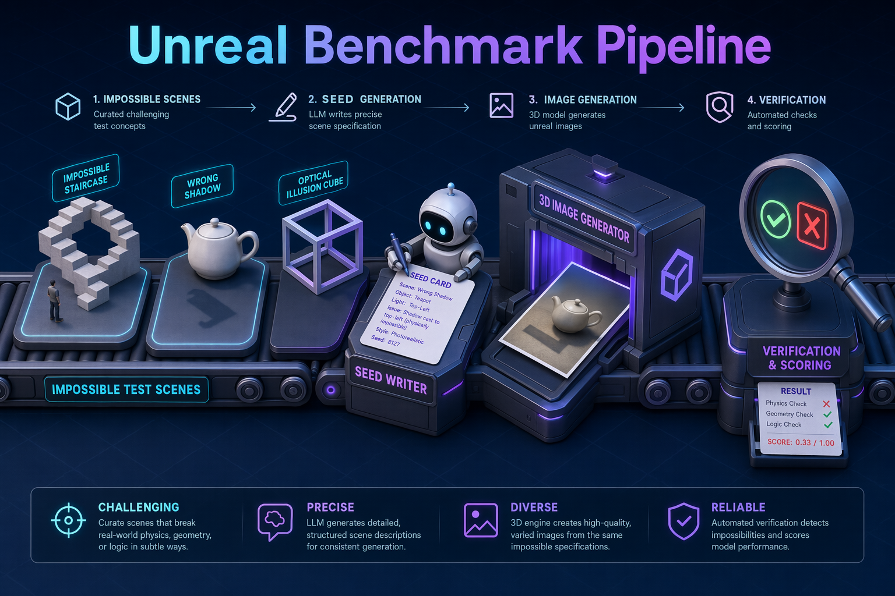

# Unreal Benchmark Pipeline

自动化合成**高难度视觉推理 benchmark** 的流水线，用于评测 VLM（视觉语言模型）。
把手写的 "seed"（场景 + 问题 + 答案 + 推理点）逐级变成:完整场景描述 → 多跳 / 复杂
元素抽取问题 → GPT-Image-2 生图 prompt → 生成图像 → 独立 VLM 闭卷验证。基准刻意瞄准
多跳推理、遮挡、细粒度辨别、光学效应与语义矛盾等强 VLM 仍会做错的题目。

## 流水线（每个 stage 独立可跑，产物落盘即为下一步输入）

**合成:** `seed_bank.json` → `stage1_gen.py`(Gemini) → `stage2_image.py`(GPT-Image-2)
→ `stage3_verify.py`(Qwen + Gemini) → `stage3_output.jsonl`

**发布与评测:** `build_release.py`(抽取验证通过样本) → `release/` → `eval_models.py`(多模型评测)
→ `eval_results/`

> 详细的目录结构、各脚本用法与设计约定见 [CLAUDE.md](CLAUDE.md)。
