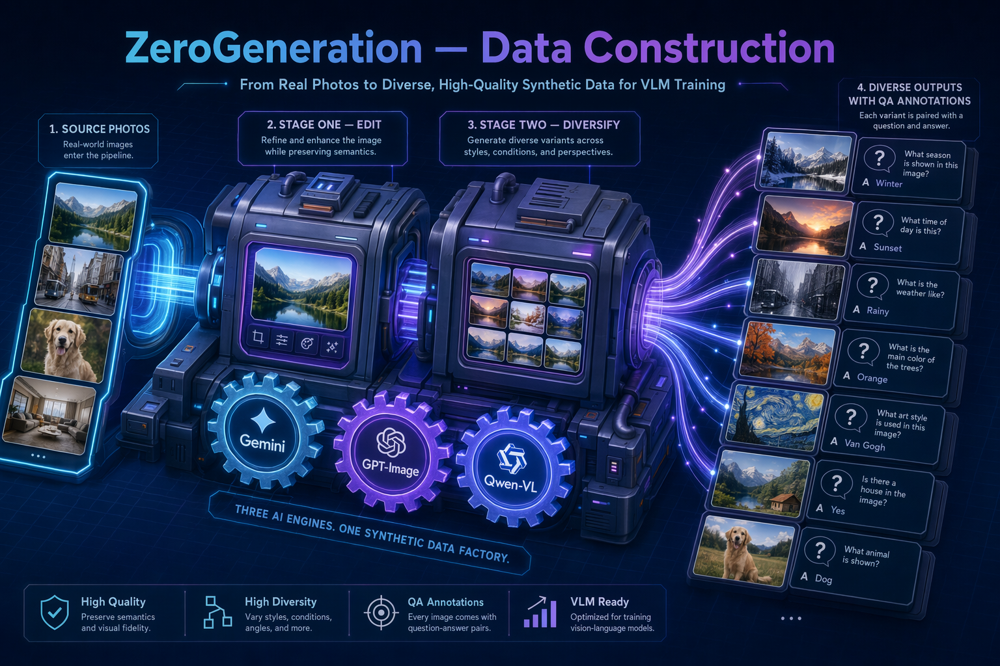

# ZeroGeneration — VLM Benchmark 数据构建



面向 VLM（视觉语言模型）评测/训练的**零样本合成数据构建**代码集合。核心思路：以一批公开
benchmark（ZeroBench / MMMU / EMMA / CharXiv / DocVQA / InfoVQA / MMStar / RealWorldQA /
HallusionBench / LogicVista / BabyVision 等）作为「种子」，用 **Gemini（题面/编辑规划/CoT）
+ GPT-Image-2（图像编辑/生成）+ Qwen-VL（视觉打分/校验）** 三类模型协同，批量产出
「新图 + 新问题 + 答案 + CoT」的合成样本，并做自动校验与格式转换。

> 本目录只收录**数据构建代码、配置与说明**。原始/产出的大文件（图片、`*.jsonl`、
> `*.parquet`、`*.tar`、可视化 HTML 数据 dump、venv、日志）均未纳入，需按下方路径自备。

---

## 1. 设计总览

所有数据集 pipeline 共享同一套「两阶段 + 三模型」范式：

```
       种子样本(公开 benchmark 图+题)
                │
   ┌────────────┴─────────────────────────────────────────┐
   │ Stage 1  «答案会变的手术式编辑 / surgical edit»        │
   │   Gemini   : 规划编辑 + 冻结考点(frozen_predicate) +   │
   │              question_template + axis_table(考点轴)    │
   │   GPT-Image: 按规划编辑原图 → 新图                     │
   │   Qwen-VL  : 校验编辑是否落地、答案是否随之改变         │
   └────────────┬─────────────────────────────────────────┘
                │  stage1_samples.jsonl (+ stage1_images/)
   ┌────────────┴─────────────────────────────────────────┐
   │ Stage 2  «考点保持的多样化 / diversify»               │
   │   Qwen-VL(Selector): 读 stage1 图 → 多套 axis 取值     │
   │   GPT-Image        : 每图产 N 张风格/构图变体          │
   │   Qwen-VL(Verifier): 4 子问题核对考点是否仍成立        │
   │   Gemini           : 生成 CoT / think 轨迹             │
   └────────────┬─────────────────────────────────────────┘
                │  stage2_samples.jsonl → convert_* → ShareGPT/think 训练格式
```

关键设计点：

- **考点冻结（frozen_predicate + axis_table）**：Stage 1 把「这道题真正考什么」抽象成
  谓词与考点轴表，Stage 2 只在这些轴上变化，保证多样化后**考点不漂移、答案可推**。
- **自动校验闭环**：每阶段都有 Qwen-VL 做视觉校验（编辑是否落地 / 考点是否仍在），
  不合格样本被丢弃（见 `filter_loop_think.py`）。
- **断点续跑**：所有 `run_*.sh` 以 `sample_key` 去重，已写入 jsonl 的样本自动跳过；
  强制重跑用 `NO_RESUME=1` 或 `--no_resume`。
- **分 API 并发限流**：`_v5_common.py` 为每个上游 API 维护独立信号量
  （Gemini / Qwen / GPT-Image 各自并发上限，可用环境变量覆盖），规避 429 / NoCapacity。
- **多端点适配**：GPT-Image helper 自动识别 endpoint 风格（`/v1` 结尾→Bearer；否则
  Azure 风格 `api-key` 头 + `?api-version=`）。

---

## 2. 目录结构

```
ZeroGeneration/
├── .env.example                 # API 凭证模板（复制为 .env 填真实 key）
├── README.md
│
├── _gemini_image.py             # Gemini 生图 helper（多处复用）
├── app.py                       # Flask 可视化：原图 vs 生成图 对比查看
├── run_gemini_banana.sh         # Gemini「banana」批量生图入口
├── create_gemini_scripts.py     # 批量生成各数据集的 gemini 调用脚本
├── filter_loop_think.py         # 过滤循环/低质 think 轨迹
├── convert_zerobench_train.py   # ZeroBench → 训练格式转换
├── analyze_zerobench_coverage.py / visualize_zerobench.py / visualize_jsonl.py
├── plot_rl_data_distribution.py # RL 数据分布统计图
├── gen_banana_list.json         # 生图任务清单（配置）
│
├── gen_zerobench-main/          # ⭐ 最完整的设计：Track A + Track B + HopChain
│   ├── run.sh                   #   统一入口: bash run.sh [track_a|track_b|hopchain|all]
│   ├── track_a/                 #   图像编辑派生（generate_stage1/stage2）
│   ├── track_b/                 #   程序化谜题：generators/ 造题 + renderers/ 渲图
│   │   ├── generators/          #     sokoban/sudoku/chess/maze/connect4/othello/
│   │   ├── renderers/           #     game2048/nonogram/pong/graph 各一对
│   │   ├── cot_gen.py           #     CoT 生成
│   │   └── run_track_b.py       #     python -m track_b.run_track_b --puzzle all ...
│   ├── hopchain/                #   多跳问题：step1 分类→step2 分割→step3 造题→step4 校验
│   ├── classify/ convert/ utils/# 分类 / 格式转换 / Gemini 客户端
│   └── outputs/hopchain/categories.json   # 多跳分类参考配置（保留）
│
├── gen_pipeline_<dataset>/      # 各数据集的 v5 两阶段 pipeline（同构）
│   ├── run_pipeline_v5.sh       #   STAGE=1|2|all bash run_pipeline_v5.sh
│   ├── _v5_common.py            #   共享基础设施（API 客户端/限流/parquet/jsonl）
│   ├── generate_samples_v5_stage1.py / _stage2.py       # v5 主实现
│   ├── generate_samples_gemini_stage1.py / _stage2.py   # gemini 变体
│   ├── prepare_<dataset>_input.py   # 原始数据 → pipeline 输入
│   ├── convert_stage1_think.py / convert_stage2_think.py / convert_to_sharegpt.py
│   └── _gemini_image.py
│   #  已收录: babyvision, charxiv, DocVQA, emma, hallusionbench, infoVQA,
│   #          logitVista, mmmu_pro, mmstar, realwordQA,
│   #          chenlifeng_{mv1,sub,v3,v4,v5,v5_legacy,v5_stage2_improved*,v6}
│
├── gen_mmmu_stage1_fangan1/     # MMMU 方案一：5 编辑(1:5) → 选项修正 → Stage3 CoT
├── gen_mmmu_stage2_fangan2/     # MMMU 方案二：直接多规划 → Stage3 lite
│
├── image_region_babyvision/     # BabyVision 图像区域 caption（step1 生成 caption）
├── gen_zerobench_output_v5/     # ZeroBench v5 产物的分析/词云脚本
├── flask_app/ + visualization/  # 可视化查看器（Flask + 静态 HTML 模板）
```

> 各 `gen_pipeline_*` 高度同构：拿任一个（如 `gen_pipeline_emma/`）即可读懂全部。
> `chenlifeng_*` 系列是同一 pipeline 的历史迭代版本，保留以备回溯。

---

## 3. 快速开始

### 3.1 环境

```bash
cp .env.example .env      # 填入真实 API key
# 依赖（各 pipeline 通用）：
pip install httpx requests openai pillow flask pyarrow pandas
```

未提供 `requirements.txt`；核心依赖为 `httpx / requests / openai / pillow / pyarrow /
pandas / flask`（异步 HTTP + 图像处理 + parquet 读取 + 可视化）。

### 3.2 跑一个数据集 pipeline（以 EMMA 为例）

```bash
cd gen_pipeline_emma
# 先冒烟（10 题，仅 Stage 1）
LIMIT=10 STAGE=1 bash run_pipeline_v5.sh
# 全量两阶段
STAGE=all bash run_pipeline_v5.sh
# 常用覆盖项：
PARQUET=<原始parquet> OUTPUT_DIR=<产出目录> MAX_CONCURRENT=16 \
GEMINI_MAX_CONCURRENT=32 QWEN_MAX_CONCURRENT=128 STAGE=all bash run_pipeline_v5.sh
```

产物默认落在各 pipeline 的 `_archive/output_v5/`（`stage1_samples.jsonl`、
`stage2_samples.jsonl`、`stage1_images/`），本仓库未收录，需自行生成。

### 3.3 ZeroBench 完整生成（Track A/B + HopChain）

```bash
cd gen_zerobench-main
bash run.sh track_b     # 程序化谜题（10 种）
bash run.sh track_a     # 图像编辑派生
bash run.sh hopchain    # 多跳问题
bash run.sh all
# 或单独跑某类谜题：
python -m track_b.run_track_b --puzzle sokoban --n 50 --stage all
```

### 3.4 MMMU 两套方案

```bash
LIMIT=10 bash gen_mmmu_stage1_fangan1/run_pipeline.sh   # 方案一冒烟
bash gen_mmmu_stage2_fangan2/run_pipeline.sh            # 方案二
```

---

## 4. 需自备的外部输入（未收录）

| 类型 | 路径示例（脚本内默认值） |
| --- | --- |
| ZeroBench parquet | `.../datasets/zerobench/data/zerobench_subquestions-*.parquet` |
| ZeroBench 原图 | `.../datasets/zerobench/images` |
| MMMU manifest | `.../wanghan/edit_mmmu/selected_data/manifest.jsonl` |
| 各数据集原始 parquet/图片 | 见对应 `prepare_<dataset>_input.py` 顶部路径常量 |

脚本内硬编码的绝对路径指向原始工程位置，迁移使用时请按需改写或用环境变量覆盖
（`PARQUET` / `MANIFEST` / `OUTPUT_DIR` 等）。

---

## 5. 安全说明

原始代码中散落着硬编码的 API key，收录时**已全部替换为 `YOUR_*` 占位符**，改由 `.env`
注入。请勿把真实 `.env` 或含 key 的文件提交到仓库（父级 `.gitignore` 已忽略
`*.jsonl` / `images/` / `.claude/` / `__pycache__` 等）。
